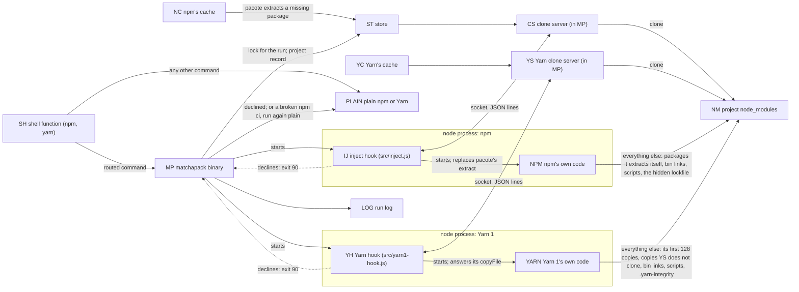

# matchapack architecture

This document explains how matchapack works inside: the shell integration, the two install engines, the store, the checks that run while it installs, and why it is built this way. It is for people who want to change matchapack, review it, or decide whether to trust it. To install and use matchapack, read the [README](../README.md). How it is tested is in [TESTING.md](../TESTING.md).

## Contents

- [Overview](#overview)
  - Diagram D1: [the whole system](#d1-the-whole-system)
- [Glossary](#glossary)
- [The shell integration](#the-shell-integration)
- [Finding npm and Yarn](#finding-npm-and-yarn)
- [The inject engine (npm)](#the-inject-engine-npm)
  - Diagram D2: [one `npm ci`, step by step](#d2-one-npm-ci-step-by-step)
  - [Start-up: the lazy hook and npm's install root](#start-up-the-lazy-hook-and-npms-install-root)
  - [How the hook enters npm's process](#how-the-hook-enters-npms-process)
  - [Which packages are cloned](#which-packages-are-cloned)
  - [The clone server](#the-clone-server)
  - [Filling the store through pacote](#filling-the-store-through-pacote)
  - [When it runs plain npm instead](#when-it-runs-plain-npm-instead)
  - [npm's errors, and a run that breaks](#npms-errors-and-a-run-that-breaks)
- [The store and its key](#the-store-and-its-key)
- [Run-time checks](#run-time-checks)
- [The install family: npm install, update and uninstall](#the-install-family-npm-install-update-and-uninstall)
  - [The repair advice](#the-repair-advice)
- [The Yarn 1 engine (macOS)](#the-yarn-1-engine-macos)
  - Diagram D3: [one Yarn 1 install, step by step](#d3-one-yarn-1-install-step-by-step)
  - [Yarn commands](#yarn-commands)
  - [When it runs plain Yarn instead](#when-it-runs-plain-yarn-instead)
- [Linux](#linux)
- [Stopping: signals, and a matchapack that goes away](#stopping-signals-and-a-matchapack-that-goes-away)
- [Store maintenance](#store-maintenance)
- [Uninstall and install channels](#uninstall-and-install-channels)
- [The run log and the report](#the-run-log-and-the-report)
- [Environment variables](#environment-variables)
- [Design decisions](#design-decisions)

Diagrams: D1 shows the parts and how a command reaches them. D2 zooms into the npm path of D1 (the nodes `MP`, `IJ`, `NPM`, `CS`, `ST`, `NC`, `NM`, `PLAIN` and `LOG`). D3 zooms into the Yarn path of D1 (the nodes `MP`, `YH`, `YARN`, `YS`, `YC`, `NM`, `PLAIN` and `LOG`).

## Overview

matchapack does not install packages itself. It starts the package manager you already use, npm or Yarn 1, and replaces one step inside it: the step that writes a package's files into `node_modules`. Where npm would extract a tarball, or Yarn 1 would copy a file from its cache, matchapack makes a copy-on-write clone instead. Everything else (which packages, which versions, where they go, scripts, bin links, lockfiles) is the package manager's own work, so the tree is the one it would build.

There are two engines:

- the **inject engine**, for npm: npm's own `npm ci`, `npm install`, `npm update` or `npm uninstall` runs in a node process that matchapack started; a hook replaces pacote's extraction (pacote is npm's library that fetches and unpacks packages) with a clone of the package from matchapack's store;
- the **Yarn 1 engine**, for Yarn 1 (classic) on macOS: Yarn's own install runs in a node process that matchapack started; a hook answers Yarn's file copies from its cache with clones of the cache files. matchapack's store is not used.

### D1: the whole system

What it is for: to see the parts of matchapack and the path a command takes. D2 and D3 show the npm path and the Yarn path in detail.



| ID | Name | What it is | Section |
|---|---|---|---|
| SH | shell function (npm, yarn) | the `npm` function, and on macOS the `yarn` function, that `matchapack init` prints into your shell | [The shell integration](#the-shell-integration) |
| MP | matchapack binary | the Rust program: gates, the clone servers, the store, the log | [The inject engine (npm)](#the-inject-engine-npm), [The Yarn 1 engine (macOS)](#the-yarn-1-engine-macos) |
| PLAIN | plain npm or Yarn | npm or Yarn run directly, as without matchapack (when matchapack starts it: with `MATCHAPACK=0` in its environment) | [When it runs plain npm instead](#when-it-runs-plain-npm-instead), [When it runs plain Yarn instead](#when-it-runs-plain-yarn-instead) |
| IJ | inject hook (src/inject.js) | the code that starts npm and replaces its extraction | [Start-up: the lazy hook and npm's install root](#start-up-the-lazy-hook-and-npms-install-root) |
| NPM | npm's own code | npm, arborist (npm's tree builder) and pacote: npm's own files, none changed on disk; in the process, IJ replaces one method, pacote's `extract` | [The inject engine (npm)](#the-inject-engine-npm) |
| CS | clone server (in MP) | answers the hook: checks each request, clones from the store. Threads inside matchapack, not a network server: no port and no socket file; reached through a socket pair whose other end matchapack gives only to the node it started (what that node's own children inherit: [How the hook enters npm's process](#how-the-hook-enters-npms-process)) | [The clone server](#the-clone-server) |
| ST | store | extracted packages, one directory per tarball integrity | [The store and its key](#the-store-and-its-key) |
| NC | npm's cache | npm's own cache of tarballs; pacote reads it | [Filling the store through pacote](#filling-the-store-through-pacote) |
| YH | Yarn hook (src/yarn1-hook.js) | the code inside Yarn that sends file copies to matchapack | [The Yarn 1 engine (macOS)](#the-yarn-1-engine-macos) |
| YARN | Yarn 1's own code | Yarn 1, unchanged | [The Yarn 1 engine (macOS)](#the-yarn-1-engine-macos) |
| YS | Yarn clone server (in MP) | answers the Yarn hook: clones a cache file to its destination. Like CS, threads inside matchapack, with a socket pair given only to the node it started | [The Yarn 1 engine (macOS)](#the-yarn-1-engine-macos) |
| YC | Yarn's cache | Yarn's own unpacked packages; the source of the clones | [The Yarn 1 engine (macOS)](#the-yarn-1-engine-macos) |
| NM | project node_modules | the tree being installed | [The inject engine (npm)](#the-inject-engine-npm), [The Yarn 1 engine (macOS)](#the-yarn-1-engine-macos) |
| LOG | run log | one JSON line per routed command that reaches matchapack (none in a Yarn 2+ project), read by `matchapack report` and `matchapack store gc` | [The run log and the report](#the-run-log-and-the-report) |

## Glossary

| Term | Meaning |
|---|---|
| copy-on-write clone (a clone) | a new file that shares its disk blocks with the original until one of them is written. On APFS (the Mac's file system) it is made with `clonefile(2)`; on Linux with the `FICLONE` ioctl. A clone is an independent file: changing or deleting one side never changes the other |
| reflink | the Linux name for the same thing; Btrfs and XFS (made with `reflink=1`) support it, ext4 does not |
| store | matchapack's directory of extracted packages, `~/.cache/matchapack/store` by default |
| store entry | one extracted package in the store, named by the integrity (`sha512-…`) of its tarball: the entry's name |
| extraction code, extraction key | the code that extracts a package (pacote's `lib/fetcher.js`, the tar code Node loads, and libuv's version), written as one key. Each entry records the extraction keys under which it is known to equal pacote's extraction. "The key" below means this key, not the entry's name |
| fingerprint | the SHA-256 of pacote's `lib/fetcher.js`; the list of fingerprints matchapack was tested with is in `src/npm-fingerprints.json` |
| hidden lockfile | `node_modules/.package-lock.json`, npm's record of what is installed |
| pacote, arborist | npm's libraries: pacote fetches and extracts packages, arborist builds and writes the tree |
| routed command | a command the shell function sends to matchapack (`npm ci`, `npm install`, `yarn`, …) |
| decline, hand over | matchapack runs plain npm or Yarn instead, with the reason, before anything was changed |
| trial scope | an optional list of path prefixes (`~/.config/matchapack/paths`); outside them matchapack runs plain npm and Yarn |
| install family | `npm install`, `npm update` and `npm uninstall` |

## The shell integration

`matchapack init` prints shell code; the line in your startup file (`eval "$(matchapack init)"`, or `matchapack init | source` in fish) runs it. It defines:

- an `npm` function (`shell/matchapack.sh`, `shell/matchapack.fish`): the routed first words go to `matchapack npm "$@"`, everything else to `command npm "$@"`, without starting matchapack;
- on macOS, a `yarn` function (`shell/matchapack-yarn.sh`, `shell/matchapack-yarn.fish`): the Yarn commands that copy packages go to `matchapack yarn "$@"`;
- a short name, `mp`, for `matchapack` (`shell/matchapack-alias.sh`), only when nothing named `mp` exists when the line runs: no alias, function, builtin or command on `PATH`. It is a function, not an alias, so a later `mp` in the startup file replaces it. `--alias NAME` picks another name and `--no-alias` defines none.

The shell code is compiled into the binary, so it updates with the binary and no checkout is needed. The line starts with `command -v matchapack` (`type -q matchapack` in fish) so that a shell without matchapack starts cleanly. It must come after every line that puts matchapack on `PATH` (Homebrew's `brew shellenv`, the install script's `env.sh`, a Node version manager), or it does nothing.

The routed npm words are npm's own first words for these commands (from npm's `lib/utils/cmd-list.js`). They live in one table, `ROUTED` in `src/wrapper.rs`; a unit test requires the same words in the same order in `shell/matchapack.sh` and `shell/matchapack.fish`, and `scripts/test-shells.sh` runs every word through the functions in bash, zsh and fish.

| npm command | First words |
|---|---|
| `ci` | `ci`, `clean-install`, `ic`, `install-clean`, `isntall-clean` |
| `install` | `install`, `i`, `in`, `ins`, `inst`, `insta`, `instal`, `isnt`, `isnta`, `isntal`, `isntall`, `add` |
| `update` | `update`, `up`, `upgrade`, `udpate`, `u` |
| `uninstall` | `uninstall`, `un`, `unlink`, `remove`, `rm`, `r` |

`u` is an alias of `update` from npm 11 on. On npm 10 the function still routes it; npm's own table gives no command, matchapack refuses the root, and plain npm prints its own "Unknown command" once.

The function looks only at the first word. A command line that starts with an option (`npm --prefix app install`) is plain npm: to find npm's command word behind options, one must know which options take a value (in `--prefix app install`, `app` is not the command; in `--no-audit install`, `install` is), and only npm's own parser knows that for sure. A copy of npm's option table inside matchapack would drift from npm.

Not routed: `install-test`, `install-ci-test`, `dedupe`, `prune` and `audit fix` (the same engine path would work, but each needs its own test cases first); `link`, `exec` and `npx` (they install into npm's global directory or npx's cache, not the project).

The functions call the `matchapack` that `command -v` names as an executable file, or a shell function of that name. An alias named `matchapack` is not used (an alias is not expanded inside a function), and then npm runs plain. The functions use the `function name {` form rather than `name() {`, because zsh would expand an existing `alias npm=…` inside `npm() {`.

Bypass for one command: `MATCHAPACK=0 npm …` or `command npm …`.

## Finding npm and Yarn

matchapack uses the npm (and Yarn) that your `npm` (and `yarn`) would run in that directory. It must start npm exactly as that command would, because install scripts see npm's environment.

- **Files on `PATH`.** nvm, fnm, Homebrew's `node`, the official installer and mise with `PATH` activation put npm's own files on `PATH`. matchapack resolves `npm` to `<npm package>/bin/npm-cli.js` (and `yarn` to Yarn 1's `bin/yarn.js`, Homebrew's launcher for it, or corepack's launcher) and starts node with it directly. No extra cost.
- **Shims.** volta, asdf and mise in shim mode put a small launcher (a shim) on `PATH` that picks a version per directory (`package.json` `volta`, `.tool-versions`, `mise.toml`). matchapack asks the shim what it starts there: it runs `npm --version` (or `yarn --version`) through the shim with a small probe loaded into node through `NODE_OPTIONS`, which reports the node binary, its arguments and its environment, and stops node before npm or Yarn runs. matchapack then starts node exactly as the shim did: the same binary, `argv[0]` and environment (the shim's `PATH` and its own variables). This costs about 40 to 110 ms per routed install (measured, medians of two runs on a busy machine: volta 40–60 ms, mise 80–90 ms, asdf 100–110 ms). Tested with volta 2.0.2, mise 2026.10.24 and asdf 0.20.2.
- **Only known launchers are asked**, each recognised by its whole install layout: volta's shim, mise's shims, asdf's shims for its nodejs plugin, and corepack's own `yarn` wrapper. They pass your arguments to npm or Yarn unchanged, whatever the command. Any other launcher or wrapper script is not run by matchapack: it runs plain npm or Yarn and names the launcher. A question with `--version` cannot show what such a wrapper would add to an install (`--ignore-scripts`, say).
- **When the start cannot be copied exactly**, matchapack runs plain npm or Yarn and says why: the shim gives node command-line options, adds arguments of its own, starts node in another directory, changes `NODE_OPTIONS`, or does not start node within 10 s; also for corepack's `npm` launcher, which is not handled.
- **`DYLD_*` on macOS.** When npm or Yarn would reach node through `#!/usr/bin/env node` (or another script run by a system binary), macOS removes `DYLD_*` variables on the way. matchapack starts node without them in that case, so install scripts see the same environment as with plain npm or Yarn.

**corepack.** When `yarn` is corepack's (`corepack enable`), corepack chooses the project's Yarn as it always does (the `packageManager` field, its defaults, its cache and downloads). If corepack starts Yarn 1's package, matchapack takes over at that point. What corepack does before Yarn starts (a download, a prompt) happens once, as with plain corepack, even when matchapack then runs plain Yarn. Tested with corepack 0.36.0 only.

## The inject engine (npm)

matchapack runs npm's own command, unchanged, in a node process it started, and replaces one method inside it: pacote's `FetcherBase.prototype.extract`, the one place where npm puts a package's files into a directory. For a package it can reproduce exactly, the hook asks the matchapack process to clone the package's store entry there; for anything else it calls pacote's own extract. npm does everything else itself, in its own order: config and arguments, the lockfile check, removing the old `node_modules`, dependency scripts, bin links, the hidden lockfile, root scripts, the audit.

```sh
matchapack install . -- --no-audit   # the engine directly; after `--`: npm's own arguments
matchapack npm ci --no-audit         # what the shell function runs
```

### D2: one `npm ci`, step by step

What it is for: to follow one install through the npm path of D1. The node names (`MP`, `IJ`, `NPM`, `CS`, `ST`, `NC`, `NM`, `PLAIN`, `LOG`) are the ones in D1.

```text
 MP matchapack binary (src/wrapper.rs, src/inject.rs)
   ① checks before npm starts: MATCHAPACK=0, MATCHAPACK_ENGINE, -g / --dry-run / --help, start
     directory inside the trial scope, npm on PATH traced to npm's own package, npm major,
     umask 022, …                             ── fails ──▶ PLAIN plain npm or Yarn
   ② takes the store's shared lock; writes IJ into a private run directory; makes a socket
     pair; starts node with IJ, as the npm on PATH would start
      │ socket on fd 3, one JSON object per line each way
      ▼
 IJ inject hook (src/inject.js), in the node process
   ③ nothing of npm loaded yet: hashes pacote's lib/fetcher.js (the fingerprint)
     not on the list ── {"declined"}, exit 90 ──▶ PLAIN
   ④ watches Module.prototype.require; starts npm's lib/cli.js with your arguments
      ▼
 NPM npm's own code
   ⑤ npm loads its config, then starts the command:
     IJ reports npm's install root ──▶ CS checks it (global, the command, installs nothing,
                                       the root exists, scope, symlinked node_modules)
                                       refused ── exit 90 before the command ran ──▶ PLAIN
   ⑥ npm loads pacote: IJ sends the extraction key to CS, checks pacote's shape, then
     replaces FetcherBase.prototype.extract
        key on the store's decline list ──▶ CS refuses every request: npm extracts everything
        shape not as expected           ──▶ no hook: npm extracts everything (no exit 90)
   ⑦ arborist builds the tree; for each package it calls extract (the hook):
        eligible? no  ──▶ pacote extracts it, as plain npm
                  yes ──▶ {"integrity","dest"} ──▶ CS clone server (in MP)
                            entry in ST, known under the running key, not picked
                                                          ──▶ clone into NM, touch, "ok"
                            missing, not yet known under the key, or picked for a check
                              ──▶ "extract_to": pacote extracts the tarball (from NC,
                                  or downloaded) into a fresh directory
                              ──▶ CS checks its times, then
                                    missing: clones it into NM; it becomes the ST entry
                                    else:    compares it with the entry ──▶ clone into NM
                            CS refuses (any error) ──▶ pacote extracts that package
                            times not as expected  ──▶ no more clones in this run (⑨: broken
                                                       if something had been cloned)
   ⑧ npm runs scripts, links bins, writes the hidden lockfile, prints its summary
      ▼
 MP after npm exits
   ⑨ writes the project record (for store gc); after a run that succeeded, warns when npm
     placed a package the hook never saw; writes one line to LOG; passes npm's exit status on
     a broken run (the result trap; an extraction no clone reproduces, after clones;
       matchapack's own failure after npm started)
        ──▶ npm ci: PLAIN, plain npm ci again; the install family: stops with the repair advice
```

1. The binary runs the checks that come before npm starts, among them that the `npm` on PATH can be traced to npm's own package (behind a version manager's shim, this starts node once with a probe that stops before npm runs; [Finding npm and Yarn](#finding-npm-and-yarn)). If one fails, plain npm runs and nothing was changed.
2. It takes the store's shared lock for the whole run (so `store gc` cannot remove an entry in use), writes the hook, `src/inject.js` (compiled into the binary), into a private run directory, makes a socket pair and starts node with the hook, the way the npm on PATH would start ([How the hook enters npm's process](#how-the-hook-enters-npms-process)). The node child gets the socket as file descriptor 3 and the environment plain npm would get.
3. Before anything of npm is loaded, the hook reads pacote's `lib/fetcher.js` from disk and hashes it. An unknown fingerprint means pacote code this build was not tested with: the hook says so and exits 90, and plain npm runs.
4. The hook starts npm's own `lib/cli.js` with your arguments. It loads nothing of npm before npm's own start-up code runs.
5. When npm has loaded its config and starts the command, the hook reports npm's install root (`npm.prefix`), whether npm is global, the command and the flags that make it install nothing. The clone server runs the checks that depend on where npm installs and pins that root. A refusal ends node with exit 90 before the command ran, and plain npm runs.
6. When npm itself loads pacote, the hook first sends the extraction key ([The store and its key](#the-store-and-its-key)); a key on the store's decline list makes the clone server refuse every request, so npm extracts everything itself. Then it checks that pacote's classes have the expected shape and replaces `extract`. A pacote of another shape gets no hook: npm is already running, so there is no exit 90; npm extracts every package itself, and the run says why.
7. For each package, the hook decides whether a clone can reproduce pacote's extraction exactly. If so, it asks the clone server, which clones the store entry into the destination. A missing entry, an entry not yet known under the running extraction key, or one picked for a check is extracted by pacote into a directory the server hands out; the server checks its times, then clones it into the destination and makes it the store entry (a missing entry), or compares it with the entry ([Run-time checks](#run-time-checks), cases A to C). A request the server refuses, for any reason, is extracted by pacote as plain npm would. If pacote's extraction is not what a clone reproduces (the time check), nothing more is cloned in this run.
8. npm finishes its own work.
9. matchapack writes the project record, compares the packages npm placed with the packages the hook saw (after a run that succeeded; a difference is a warning), writes the log line, and exits with npm's status. A run that broke (the result trap, an extraction no clone reproduces after something was cloned, or matchapack's own failure after npm started): `npm ci` runs again as plain `npm ci`, and `npm install`, `update` and `uninstall` stop with the repair advice ([npm's errors, and a run that breaks](#npms-errors-and-a-run-that-breaks)).

### Start-up: the lazy hook and npm's install root

**The lazy hook.** The helper loads nothing of npm before npm's own start-up code runs. A watcher on `Module.prototype.require` notices when npm itself has loaded `lib/npm.js`, and later the pacote that was hashed, and acts then; it removes itself once both were seen. So npm's process is plain npm's, `fs` patches and module load order included. An earlier version loaded npm's modules first and wrapped npm's `graceful-fs` set-up, which copies a start-up step whose place moved between npm 10.5 and 10.6.

**The fingerprint gate.** The fingerprint is the SHA-256 of the bytes of pacote's `lib/fetcher.js`, found next to the file npm's arborist resolves `pacote` to, read without loading it. That file holds the `FetcherBase` class whose work the hook replaces, including the private methods (`#extract`, `#tarxOptions`, `#entryMode`) that decide modes, names and file kinds. A release that changes any of that changes the fingerprint. The list in `src/npm-fingerprints.json` (eight fingerprints for npm 10.0.0 to 12.2.2) is compiled into the binary. `MATCHAPACK_NPM_FINGERPRINT=any`, or a comma-separated list, accepts more; a list is added to the shipped one. A fingerprint is added to the file only after `scripts/test-inject.sh` and `scripts/verify-npm.sh` pass with an npm that has it.

**npm's install root.** When npm starts its command (its config loaded, the command not run yet), a wrapper around `Npm.prototype.exec` reports `npm.prefix`, `npm.global`, the command (as npm's own table names it) and the flags that make it install nothing. So where npm installs is npm's own answer: `npm ci` inside a workspace of a monorepo clones into the workspace root's `node_modules`, and `npm ci --prefix <dir>` into that directory. matchapack runs every gate that depends on the location on that root and pins it: the server clones only inside it. There is no config load of its own before npm: that would cost one more node start per command, and could disagree with npm.

**The npm version gate.** npm must be a major version this engine has been run on: 10, 11 or 12 (`INJECT_NPM_MAJORS` in `src/wrapper.rs`). There is no code per npm version, so every 10.x, 11.x and 12.x passes this check; the fingerprint gate catches a release whose extraction changed. `MATCHAPACK_NPM_VERSIONS` replaces the majors: `any`, or a comma-separated list (`11.19` means 11.19.x, `13` means 13.x; so `11.19,13` turns away every other version, 11.20 included).

### How the hook enters npm's process

- The binary writes `inject.js`, which is compiled into it, into a private run directory (`<store>/tmp/<pid>-<nanos>-run`, mode 0700, removed after the run; one left behind by a crash is removed by a later run once it is an hour old).
- It starts node the way the `npm` on PATH would start it (the same node binary and, behind a version manager's shim, the shim's environment) with `inject.js <npm's package directory> <your arguments>`, the socket as file descriptor 3, and two variables of its own (the descriptor number and the accepted fingerprints).
- The hook removes those variables, and its test variables, from its environment, sets `process.argv` to npm's `bin/npm-cli.js` and your arguments, and calls npm's own `lib/cli.js`.

So the scripts npm runs see npm's own environment: `npm_execpath` (npm's `bin/npm-cli.js`, which npm takes from its own directory), `npm_config_*`, PATH and your variables, and no variable that matchapack adds (a `MATCHAPACK_*` variable you set yourself is passed on like your other variables). What differs from plain npm: inside npm's own process, `require.main` is the hook, not `npm-cli.js`; the hook has wrapped `process.emit` (to note signals, [Stopping](#stopping-signals-and-a-matchapack-that-goes-away)), npm's `Npm.prototype.exec` (to report the root) and pacote's `extract`. Install scripts on macOS do not inherit the socket (checked: a root script sees no open descriptor above 2); on Linux this was not checked, and a script holding it could only ask for clones the server's checks allow. An `npm` that a script runs is plain npm: the shell function exists only in interactive shells.

### Which packages are cloned

A package is cloned only when the result is exactly what pacote would extract. The rules are in `src/inject.js` (`ineligible`):

- pacote fetches it as a tarball from a registry or another URL (its `RemoteFetcher` and `RegistryFetcher` classes) with an integrity, which names the store entry. A git dependency, a `file:` tarball and a directory link are not, so npm's own pacote handles them (a git dependency may run its `prepare` script);
- npm's default file modes, and the process umask is 022;
- the lockfile entry has a `resolved` URL and an `integrity` (without `resolved`, pacote fetches the package's manifest first and marks its bins executable while extracting; without `integrity`, there is no entry name to look up). A lockfile whose entries lack them saves nothing;
- the fetcher has not loaded the package's manifest for itself (pacote would then mark bins executable during extraction);
- pacote's `allowGitIgnore` is off (the default: pacote renames `.gitignore` to `.npmignore`, and the store holds that);
- with `--install-strategy=linked`, npm's fetchers carry no integrity, so npm extracts every package itself: nothing is cloned, and the tree is npm's.

Checked with a `file:` tarball, bundled dependencies and a git dependency (the git dependency on npm 10.5.2, 10.9.10, 11.19.1 and 12.2.2): the git dependency and the `file:` tarball are extracted by npm, bundled dependencies come with the clone of the package that ships them, everything else is cloned, and the tree equals plain npm's. A shrinkwrap follows the same rule but has not been run.

### The clone server

The clone server runs in the matchapack process, on threads of its own (as many as the machine has cores; `MATCHAPACK_INJECT_THREADS` changes it). It is not a network server: it has no port and no socket file, and nothing has to connect to it. Before starting node, matchapack creates a connected pair of sockets (`socketpair(2)`, a Unix-domain socket pair, on macOS and Linux alike) and gives node one end as fd 3; only a process holding that end can send requests: node and the hook in it (install scripts do not inherit it on macOS; on Linux see above). Requests come over the socket, one JSON object per line, and are served concurrently (npm starts every extraction at once; those beyond the thread count wait their turn, as npm's own file work waits for Node's I/O threads, four by default). If a request cannot be served, npm extracts that package itself; if matchapack goes away, npm stops (see [Stopping](#stopping-signals-and-a-matchapack-that-goes-away)). `src/serve.rs` documents every message.

- **Transport.** A socket pair, inherited by node as fd 3. Not the child's stdin or stdout: they are your terminal, which npm and its scripts need. Not a named socket: a path can exceed macOS's 104-byte limit, and any process of the user could connect. Not a server that node starts: the server would then learn the store and the project root from node, which would make its path checks pointless.
- **The source is named by integrity, not by path.** The server parses the integrity string with the store's own parser and derives the entry path from the digest, so a request cannot name a source outside the store. The entry must be a real directory.
- **The destination** must be a plain absolute path, inside the pinned root, below a `node_modules`, and absent or a real directory holding nothing but `node_modules`. All writes use the resolved path. A destination npm chose elsewhere (a workspace directory that is a symlink out of the project) is refused, and npm extracts there itself.
- **Placement.** npm creates each package directory before extracting into it. If it is empty, the server removes it and clones the entry there (one `clonefile(2)` of the whole directory on macOS): "fast". If it already holds `node_modules` (nested packages), the server clones into a temporary directory in the store and renames each top-level entry in, merging a `node_modules` the package ships itself (bundled dependencies): "merge". The temporary directory is under the store because that is the one place known to be on the project's volume whenever a clone works at all.
- **Times.** Every placed path gets the current time (a package that pacote extracted in this run already has it), per package and before the answer, because npm runs install scripts after every extraction has finished, and their output must keep later times than the package's own files, as with `npm ci`. The server walks the store entry, not the destination, because the destination's `node_modules` holds other packages being placed at the same moment.
- **File group.** A directory clone on macOS gives the cloned tree the group of the directory it is created in. Placements cloned at the destination are therefore right; merges, made in the store's temporary directory, are not, so the server changes a placed path's group when it differs from what the kernel would give a new file there (the project directory's group on macOS; the process's, or a setgid directory's, on Linux). When the user is not in that group (a project under `/tmp`, group `wheel`, on macOS), it cannot: a merge placement is then refused and npm extracts that package. The tree is the same either way; only the disk saving is lost.
- **Errors.** Any error is answered as an error, and the hook lets pacote extract. A clone the filesystem refuses (`EXDEV`: source and destination on two filesystems; `ENOTSUP`: no clone support) is answered as fatal: the hook stops asking, and npm extracts the rest of the install. matchapack says so.

### Filling the store through pacote

The store is filled by pacote itself, during the install, never by an extractor of matchapack's own.

- A request for a missing entry is answered with `extract_to`: a fresh directory in the server's temporary directory, created under umask 022 as pacote's `mkdir` would. The hook calls pacote's original `extract` on the fetcher npm made for that package, into that directory. So the entry is made by the same code, options and tarball as npm's own extraction, and a package that is neither in the store nor in npm's cache is downloaded by pacote and cloned in the same install.
- The filled directory is accepted back only once, for the integrity it was handed out for. It becomes the store entry by a rename that succeeds only if no entry exists yet. Two installs filling one entry at once: each installs its own extraction, the second rename fails, and that install drops its copy. An install whose extraction comes back after the entry appeared compares the two instead, as in a check.
- No pre-fill before npm starts. matchapack does not read npm's arguments or settings, so only npm knows where its cache is (`--cache`, `.npmrc`, `npm_config_cache`). A pre-pass would also work from the lockfile text and extract entries npm does not install (`--omit=dev`, other platforms), and it would cost time when the store already has everything, the common case.
- **The time check.** pacote's extraction must hold only files and directories, and none may be more than an hour older than the install (`EXTRACTION_TIME_SLACK`). pacote extracts with `noMtime`, which is what a clone touched to now reproduces; a tar (or pacote, Node, libuv) that started keeping the tarball's times would give npm's fixed 1985 dates. When it fails, the hook leaves that package and every later one to npm, and the extraction code goes on the store's decline list ([The store and its key](#the-store-and-its-key)).

### When it runs plain npm instead

matchapack runs plain npm, and prints why, in these cases. Most are decided before npm starts. Those marked "npm's root" are decided on the root npm reports, after npm loaded its config and before its command ran, so the project is unchanged (one npm debug log of about 1 KB stays in npm's `_logs`).

- the `npm` on `PATH` cannot be traced to npm's own package, or cannot be started exactly as it starts ([Finding npm and Yarn](#finding-npm-and-yarn));
- npm is not version 10, 11 or 12;
- pacote's `lib/fetcher.js` is not on the fingerprint list (after a new npm release: update matchapack, or set `MATCHAPACK_NPM_FINGERPRINT`);
- the umask is not 022;
- npm installs globally: `-g`, `--global`, `--location=global` on the command line, or (npm's root) `global=true` in the environment or any npmrc;
- the install root's `node_modules` is a symlink (npm's root);
- the install root is outside the trial scope. The start directory is checked before npm starts unless `--prefix` or `-C` was typed; then npm's root is checked. A `paths` file that cannot be read counts as no file: no scope, so matchapack runs everywhere. Scope entries are path prefixes: `~/git/app` covers `~/git/app-feature`, and a prefix that is no directory, or a directory removed since, is a good entry (its parent's symlinks are resolved, so `/tmp/app` matches `/private/tmp/app-feature`). A scope with no entry that can match, and an entry that can never match (`$HOME/git` typed literally, a relative path), say so in the reason;
- the install root does not exist (`--prefix` naming a new directory; npm's root);
- the command installs nothing: `--dry-run`, `--package-lock-only`, `--help` (npm's root also catches them set in an npmrc);
- npm maps the routed word to another command (npm's root: `npm u` on npm 10);
- `MATCHAPACK_ENGINE` is set to anything but empty or `inject` (an earlier engine, `classic`, was removed before the first release).

For `npm install`, `update` and `uninstall`, three of these print nothing: a global install, a project outside the trial scope (but not a scope entry that can never match, since that may not be the scope meant), and a command that installs nothing. These commands are typed often (`npm install -g <pkg>` above all), and the line would repeat what the user already knows. The run is still logged as declined, with the reason. `npm ci` prints the line for every reason.

When the filesystem cannot clone, npm extracts every package itself, and matchapack says so: the first clone the filesystem refuses stops cloning for that install. The same happens, said the same way, when npm's root cannot be read (an npm whose `Npm` class changed) or pacote turns out, once npm has loaded it, not to have the shape the hook needs. A directory without `package.json` or a lockfile is npm's to judge: npm finds its root above it, or prints its own error.

`MATCHAPACK_NO_FALLBACK=1` turns every decline into exit 3 with nothing changed, instead of plain npm (`scripts/convert-existing.sh` and `scripts/bench.sh` use it).

### npm's errors, and a run that breaks

- npm's own errors (a lockfile out of sync, a failing script) are printed once, by npm, and its exit status is passed on. matchapack never runs npm a second time for them: `npm ci` would fail the same way.
- `npm ci`'s own output comes back, the `npm audit` summary included (and its network request; `--no-audit` turns it off, as with npm).
- **A broken run** is one where npm read something of the hook's result that pacote's own result does not have (the result trap, [Run-time checks](#run-time-checks)), or pacote's extraction was not what a clone reproduces after something had been cloned ([The store and its key](#the-store-and-its-key), the decline list), or matchapack itself failed after npm started. For `npm ci` through `matchapack npm` (not a run stopped by a signal, see [Stopping](#stopping-signals-and-a-matchapack-that-goes-away), and not `matchapack install`, which only reports the error), matchapack removes the package directories it placed in that run outside the root's `node_modules` (`npm ci` before npm 10.8.1 keeps what it finds in a workspace member's own `node_modules`), then runs plain `npm ci`, which removes the root's after checking the lockfile. For the install family, it stops with the repair advice ([The repair advice](#the-repair-advice)).

## The store and its key

**Layout.** `~/.cache/matchapack/store` by default (`MATCHAPACK_STORE` moves it):

| Path | What it holds |
|---|---|
| `v2/<algo>/<first 2 hex>/<rest of the hex>/` | one entry: the package root as pacote extracts it, named by the tarball's integrity |
| `made-by/` | per entry, the keys of the extraction code under which it is known to equal pacote's extraction |
| `declined/` | one file per extraction code whose extraction a clone cannot reproduce: the key, the reason, and the matchapack build that recorded it (`build: <version (commit)>`), on three lines |
| `projects/` | one record per installed project: its directory and the entries it uses (for `store gc`) |
| `sizes/` | cached entry sizes |
| `tmp/` | work directories; an entry is written here and renamed into place, so a present entry is always complete |
| `lock` | held shared by every install, exclusively by commands that remove entries |

An entry is removed the same way in reverse (renamed out, then deleted), so a crash never leaves a half-deleted entry that would read as present. The layout version (`v2`) is bumped whenever the entry format changes.

**The key is the extraction code**, not version numbers. It is one line of three parts, separated by spaces (shown here one part per line):

```text
fetcher:<first 32 hex of the SHA-256 of pacote's lib/fetcher.js>
tar:<first 32 hex of the tar fingerprint>
uv:<libuv's version>
```

- The **fetcher** part is the fingerprint of the gate above: one concept, used twice.
- The **tar fingerprint** (`tarFingerprint` in `src/inject.js`) covers tar's package and every package in its `dependencies`, transitively, found as Node finds them: the `<name>@<version>` of each, and the SHA-256 of every file of those packages that Node has loaded (and, when one of them is an ES module, of every ES module file in them). Each package's own `package.json` is left out, so that code that only reads a version does not change the fingerprint.
- **libuv's version** (Node's file-system library): a libuv release could change the bytes or modes that `open`, `write` and `mkdir` leave. Node's own version and zlib are not in the key. This part is a version, not code: Node also changes libuv's code under one version number (its copy code changed from Node 26.0 to 26.2 under libuv 1.52.1), and such a change is not seen by the key; the one-in-50 sample and `store verify` cover it.

The key is computed when npm itself has loaded pacote (which loads tar) and sent before the hook is installed, so every request sees it. `node src/inject.js --key <npm dir>` prints it, and the tar fingerprint on a second line.

Why the code and not the version numbers: an npm release that changes none of the extraction code (often only pacote's version number moves) then compares nothing, and switching back and forth between two npm or Node versions compares nothing again. Over npm 10.0.0 to 12.2.2, the key changes in 23 of 73 release steps. It also covers two gaps a version key has: tar's dependencies, which were separate packages in tar 6.x to 7.5.7, and code patched in place under the same version number (for pacote and tar; not for libuv, above).

**The one-time comparison.** When an entry is about to be cloned under a key that its record does not have, pacote extracts the same tarball and the two are compared file by file: the same paths, contents, and file and directory modes. Equal: the key is added to the record and the entry is cloned. Different: the entry is replaced by pacote's extraction (the old one renamed aside first, so an install cloning from it at that moment gets the whole old entry or an error, never a mix), which is what gets installed, and matchapack says so. A difference never blocks the engine: replacing makes each compared entry right, while blocking would leave every later install slower.

After an upgrade that changes the key, the first install compares each entry it uses once: 1.7 to 2.8 times a plain `npm ci` in the benchmark, for the packages that install uses (a second project using the same packages compares nothing), and the summary says so. `matchapack store verify` does the same work ahead of time for the whole store (for each entry whose tarball is still in npm's cache).

**The decline list.** If pacote's extraction under some code stops being what a clone reproduces (the time check above), matchapack stops cloning in that install and says so. When something had already been cloned, the install counts as broken: plain `npm ci` rebuilds it, and the install family stops with the repair advice. When nothing had, the install is npm's own and stands. Either way the code goes on the decline list, and later installs under it, by the same matchapack build, are npm's own. A decline holds only for the build that recorded it: another build (an upgrade or a rebuild of matchapack) compares again and declines again only if the extraction is still not what a clone reproduces. To try that code again with the same build, delete its file (`grep -lx '<key>' <store>/declined/*` finds it; deleting the directory clears them all). When the hook cannot compute the key at all, the key is unknown: it vouches for nothing, every entry is compared before it is cloned (unless `MATCHAPACK_INJECT_CHECK=off`), and nothing is declined.

## Run-time checks

What keeps matchapack right on an npm release it has not seen is checked while it runs. Before every run, the fingerprint gate: pacote's `lib/fetcher.js` must be on the list, or the run is plain npm. Then, per package:

| Situation | What happens | How often |
|---|---|---|
| A. The package is not in the store | pacote extracts it, and that extraction becomes the store entry (after the time check) | every run, for new packages |
| B. The entry is not yet known under the running key | pacote extracts it and it is compared file by file with the entry: equal, the key is recorded and the entry cloned; different, the entry is replaced by pacote's extraction | once per entry and key: after an npm or Node upgrade that changed the extraction code |
| C. The entry is known under the running key | cloned without a comparison, except one in 50 at random, which goes through B's comparison | every run |
| D. The result trap: npm reads a field of the hook's result that a clone may not give | the run counts as broken: `npm ci` is rebuilt with plain npm; the install family stops with the repair advice | every run |

Why C does not compare everything: the same tarball (fixed by its integrity) through the same extraction code gives the same files, and B has already shown them equal to the entry, so a second comparison adds nothing. The one-in-50 sample is a safety net for what the key does not cover (a store file changed or damaged since, Node's own file-system layer, zlib, the operating system), not a speed-up. To check the whole store at once after an upgrade, run `matchapack store verify`.

`MATCHAPACK_INJECT_CHECK` (`should_check` in `src/serve.rs`): a number N (50 when unset) compares one in N entries known under the running key and always compares an entry not yet known under it; `all` compares every entry; `off` compares nothing at all, B included, so after an upgrade that changed the extraction code nothing is compared before it is cloned. To make the sample cheaper, set a larger number, not `off`. Measured earlier, not with the benchmark's method (a project of 27 direct dependencies, 3,840 packages installed, `--ignore-scripts`, medians of three rounds): plain `npm ci` 14.6 s; matchapack with a warm store and no comparison 7.5 s; with the default one-in-50 sample 8.0 s, so the sample costs about 0.5 s (7 %) and 2.7 s of CPU per install there. The fingerprint gate and the result trap cost milliseconds.

Two more checks run after npm exits:

- **Packages the hook never saw.** matchapack compares the packages of the hidden lockfile whose own `package.json` this run wrote (the packages npm extracted, whether new, changed or restored) with the destinations the hook saw. More on npm's side means npm placed packages without calling `extract`: the sign that the hook no longer fits a new npm. Installs stay correct, only slower; the install prints a line and `matchapack report` counts the runs. It is a warning only: an install script or another npm can also place packages.
- **The result trap** (D above) is a wrapper on the object the hook returns: if npm reads any field other than the three that pacote's result holds today (`resolved`, `integrity`, `from`), the run counts as broken. It catches an npm that starts to use more of what `extract` resolves to, which a clone's result may not give.

The Yarn 1 engine has no comparison while it runs: it clones from Yarn's cache at Yarn's link step, with no store and no extraction to compare with. That is why the sampled verification of real runs ([TESTING.md](../TESTING.md#sampled-verification-of-real-runs)) matters more for Yarn.

## The install family: npm install, update and uninstall

`npm install`, `npm update` and `npm uninstall` run through the same engine as `npm ci`. npm decides what to add, change or remove, writes `package.json`, `package-lock.json` and the hidden lockfile, and leaves alone what it does not change; only its extraction of the packages it adds or changes is replaced by clones. matchapack writes none of those files. So:

- a fresh `npm install` (no `node_modules` yet, as in a new worktree) saves as much as `npm ci`; `npm install <pkg>` and `npm update` save the packages they add or change; `npm uninstall`, and an `npm install` with nothing to do, place nothing and print nothing of matchapack's;
- packages that were in `node_modules` before stay as they are: a `node_modules` built by plain npm keeps its full copies until one `npm ci` (or `scripts/convert-existing.sh`);
- every routed command starts matchapack and writes one log line; one that is not declined before npm starts also takes the store's shared lock, so it waits while `matchapack store gc` or `store verify --fix` holds the store. The cost is about one more process, within the noise of npm's own run.

What held unchanged for an incremental install: the hook, its eligibility rules, both placement paths, the store fill and checks, the times of placed paths, and the destination check. When npm calls the hook, the destination is empty or holds only `node_modules`, as in `npm ci`: arborist renamed the old directory aside and made a fresh one first, and moves unchanged nested packages back after the clone. Two things had to change:

- **Packages the hook never saw** compares destinations, not counts: the packages of the hidden lockfile whose own `package.json` this run wrote, against the destinations the hook saw (each request and each package left to npm). Counting every package in the hidden lockfile gave a false alarm on every `npm install` of an installed tree. The check stays silent on an incremental install, also where npm keeps a package the hidden lockfile did not list, where a kept package gets a nested `node_modules`, and with npm 10's `--install-strategy=linked`. On a filesystem with 1-second timestamps the count can vary between runs; nothing is cloned there anyway.
- **The project record** for `store gc` follows npm's hidden lockfile: when that file names where every installed package came from, the record is exactly its packages, so entries of removed or replaced packages drop out, and a record that fell behind (after a Ctrl-C) is completed by the next routed command. When it does not (a project without `package-lock.json` whose hidden lockfile npm stopped trusting), nothing is dropped.

### The repair advice

If a command of the family breaks (the result trap fired, or matchapack itself failed after npm started), matchapack does not repair anything by itself. Running the command again would not rebuild what is in place, and `npm ci` is a rebuild from the lockfile, not what plain `npm install` would have left (the project's own install scripts run, a workspace command ends with another set of packages, local state in `node_modules` is lost). It stops with a non-zero status and prints the repair that fits, from npm's own settings for that run: a sentence or two, then each command on a line of its own.

Every form first removes the package directories matchapack itself placed in that run outside the root's `node_modules` (a workspace member's own packages, a package under a `file:` dependency): `npm ci` before npm 10.8.1, and an install, keep what they find there. Nothing else: not what another tool or an earlier install put there, and nothing behind a symlink to outside the project. Each directory is on a line of its own; more than 20 are listed in a file in the run log's directory (readable by you only; lists older than a day are removed), removed by one command. Of a package directory that has a `node_modules` (npm keeps nested packages there), only the other entries are removed, and only if it is still the directory matchapack placed when the advice is written (npm puts its own back when it rolls back after a failed install script; the printed commands do not check this again).

Then one of:

- **usually**: check `git diff` of `package.json` and `package-lock.json`, then `MATCHAPACK=0 npm ci <the same arguments>`;
- **no lockfile to rebuild from** (no `package-lock.json` or `npm-shrinkwrap.json`, or `--no-package-lock` / `package-lock=false`), or `--no-save` (not for `npm update`): `npm ci` would refuse, install an old lockfile, or leave out what the run added, so: remove `node_modules` and run the same command with plain npm;
- **a command filtered to some workspaces** (`-w`, `--workspaces`, or started inside a member): `npm ci` with the filter would remove the other workspaces' packages, so: rebuild the whole project, `MATCHAPACK=0 npm ci --prefix <root> <its options>`, without the filter;
- **both**: remove `node_modules`, reinstall the whole project the same way (`npm install` instead of `npm ci`), then run the command again.

The options in the whole-project command are the ones npm parsed from your command line (the other commands repeat your arguments as you typed them), written out one per value as npm holds them: full option names, absolute paths, ISO dates, `--audit=false` for `--no-audit`. Each such list is parsed again by npm's own parser and given only when npm reads it exactly as it read your command line. When it does not (a line npm reads oddly, such as a list option given `false`), the command is given without any options, and the advice names every option it could not repeat. A filter set in the environment is removed with `env -u`; a filter set in an npmrc file is named, since a command line cannot unset it. `--prefix <root>` run from where you are is close to, not the same as, running at the root: install scripts see `INIT_CWD` as the directory you ran it in, and a relative path in an npmrc value resolves against that directory.

Credentials typed on the command line (`--//host/:_authToken=…`, `--_password=…`, npm's client key `--key=…`, a secret in a URL's query such as `?private_token=…`) are shown as `***`, as in the run log, and the advice says to add them back or put them in `.npmrc`. The advice works the same after a panic of matchapack, since npm's settings for the run are kept apart. When a run breaks before npm reported its install root, matchapack had placed nothing, and the advice is only the same command again with plain npm.

For tests, `MATCHAPACK_TEST_BROKE=1` makes a run of the family end as if its child status was lost, `=panic` as if matchapack panicked after npm ran, and `=no-server` as if the clone server's thread could not start (matchapack then stops npm before it answers).

## The Yarn 1 engine (macOS)

In a Yarn 1 project, `yarn` runs your own Yarn 1, as it always did, with one change inside it. Where Yarn would copy a package file from its cache into `node_modules`, matchapack makes a copy-on-write clone of the cache file instead. The clone shares its disk blocks with the cache file, so N worktrees of a project cost about one copy on disk: the one in Yarn's cache. Everything else is Yarn's own: which files go where, the skipping of files that are already in place, bin links, install scripts and `.yarn-integrity`. matchapack's store is not used (only its `tmp/` directory holds the run's hook file), so `store gc`, `store verify` and the project records do not see these installs.

During its link step, Yarn 1 copies each file with `fs.copyFile(src, dest, COPYFILE_FICLONE)`. On macOS, in the Node releases tested, Node's copy with that flag writes a full copy; matchapack answers each such call with a `clonefile(2)` of the cache file.

### D3: one Yarn 1 install, step by step

What it is for: to follow one install through the Yarn path of D1. The node names (`MP`, `YH`, `YARN`, `YS`, `YC`, `NM`, `PLAIN`, `LOG`) are the ones in D1.

```text
 MP matchapack binary (src/yarn1.rs)
   ① gates: Yarn 1 found on PATH, yarn.lock at or above, not Yarn 2+, scope, …  ── fails ──▶ PLAIN
   ② writes the hook; starts node with YH (socket on fd 3)
      ▼
 YH Yarn hook (src/yarn1-hook.js), in the node process
   ③ reads N from the Yarn code that runs (its copy concurrency); not found ──▶ decline, as in ④
   ④ probes Node's own copy: which times and which group does a copy keep?
     a non-empty copy kept its time, or shares blocks ──▶ decline (exit 90) ──▶ PLAIN
   ⑤ replaces fs.copyFile; says hello with the facts; starts YARN Yarn 1's own code
        MP, at the hello: asks `yarn cache dir` (a second node), in parallel with the install
      ▼
 YARN link step: copyFile #1 … #N   ──▶ Node's own copy (Yarn's time probe sees real copies)
                 copyFile #N+1 …    ──▶ {"src","dest"} ──▶ YS Yarn clone server (in MP)
                                          waits for the cache root (until 10 s after YS started)
                                          src: a regular file inside YC; dest: inside the
                                          project, below a node_modules (NM)
                                          clonefile ──▶ fix-up (group, extended attributes, times)
                                    ok ──▶ Yarn's own time fix, as after a copy
                                    not ok ──▶ Node's copy of that file
   ⑥ Yarn runs scripts, writes .yarn-integrity
      ▼
 MP prints the counts; writes one line to LOG; passes Yarn's exit status on
```

1. The binary runs the gates ([When it runs plain Yarn instead](#when-it-runs-plain-yarn-instead)).
2. It starts node with the hook. Once the hook says hello, it asks the same Yarn for its cache folder (`yarn cache dir`, with the same working directory, environment and cache arguments), in parallel with the rest of the install. The install's node starts alone: starting both at the same moment could delay the install's start (see TESTING.md, "Benchmark"), and the cache folder is needed only at the link step, seconds later. If the hook declines, `yarn cache dir` is not started at all.
3. The hook reads N, Yarn's number of concurrent copies, from the Yarn code that runs (`CONCURRENT_QUEUE_ITEMS`). If it cannot find it, it declines.
4. It probes Node's own copy on two small files: which times (access, modification) and which group a copy keeps. A non-empty copy that kept its modification time (a libuv that writes the data before setting the times), or a copy that shares blocks with its source (a Node that already clones), makes it decline: plain Yarn.
5. It replaces `fs.copyFile` and sends those facts in its hello. Yarn's first N copies go to Node. Every later copy is a request to the server.
6. Yarn finishes its own work; matchapack prints how many files were cloned and logs the run.

**The first N copies are left to Node, by design.** Yarn checks once, on the first files it copies, whether a copy keeps the source's times; if not, it sets each file's times itself afterwards ("fixTimes"). That check must see real copies, or Yarn would draw the wrong conclusion for every file. Yarn's copy queue runs N at a time and starts copy N+1 only when one has finished, its time fix included, so leaving the first N to Node is enough. N is 128 (Yarn's `CONCURRENT_QUEUE_ITEMS = fs.copyFile ? 128 : 4`, read from the Yarn code that runs). So a `yarn add` that copies 128 files or fewer clones nothing (`typescript`: 117 files, 30.9 MiB, none cloned; `date-fns`: 4,783 files, 94 % of its bytes cloned). On a full install the 128 are noise. The end-of-install line says "128 copied by Node (Yarn's first copies, left to Node by design)".

**Each clone is made to look like Node's copy.** Times and group as the probe found Node's copy sets them (measured at the start of each install), and extended attributes removed, except one that cannot be: macOS's `com.apple.provenance` of a clone carries the value of its cache file. A source with BSD file flags (compressed, hidden) is not cloned, since a clone would carry them and a copy does not. Nor is a source with setuid, setgid or sticky bits: `clonefile(2)` clears setuid and setgid, which Node's copy keeps. In `yarn workspace <name> …`, the workspace's Yarn probes Node's copy again; if it finds other facts than the first probe, all its files are Node's copies. A fix-up that fails removes the clone, and Node copies the file.

**The cache root.** Requests wait for `yarn cache dir` to answer, up to 10 s from the server's start: with a warm cache, a small install reaches its link step before `yarn cache dir` answers, and answering "copy" at once cloned nothing. A source must be a regular file whose parent is inside that cache root. A cache on another volume than the project means nothing can be cloned: Yarn installs with its own copies, and matchapack says so.

**A known change ahead.** A libuv change merged in November 2026 (copy times set after the copy), not yet in a released Node when this was written, gives a probe result the engine does not handle yet. With a Node that carries it, the engine would decline every install: Yarn runs plain and the tree stays correct, but nothing is cloned. The Node release watch ([TESTING.md](../TESTING.md#the-npm-canary-and-the-node-and-yarn-release-watch)) shows the first Node release that carries it.

**Failures end in Node's copy of that file.** `EXDEV`, `ENOTSUP`, `EOPNOTSUPP` and `ENOSYS` are fatal (the hook stops asking). When the socket closes, pending and later files are Node's copies. A request not answered in 30 s makes later files Node's copies, but itself keeps waiting for its answer (a copy made at once could race a clone that matchapack is still making at that path). So the 30 s limit does not bound the install: a matchapack that stays alive but stops answering holds Yarn up; only a closed socket ends the wait. Yarn's exit status is passed on; nothing is retried.

**Yarn's cache now carries the shared blocks.** A cloned file shares its blocks with the cache file it came from. `yarn cache clean` breaks nothing (a clone is an independent file), but frees nothing while worktrees still share those blocks, and the next install shares with the new cache entries only.

**Existing `node_modules`.** Yarn skips files that are already in place, so an existing `node_modules` keeps its own copies until it is removed once (or `scripts/convert-existing.sh` re-installs it).

**Git and `file:` dependencies** go through Yarn's cache like any package and are cloned at the link step. Yarn copies a `file:` directory into a new cache entry on every install (plain Yarn's own behaviour), and unpacks a `file:` tarball into an entry keyed by its sha1, which later installs reuse. Checked: trees identical to plain Yarn for a directory, a tarball, both together with registry packages, and a workspace that depends on a sibling through `file:../lib`. Plain Yarn ignores edits to a `file:` directory while `.yarn-integrity` still matches ("Already up-to-date"); so does matchapack.

### Yarn commands

The `yarn` function routes the commands that copy packages into `node_modules`: a bare `yarn`, `yarn install …`, `yarn` with a flag first (`yarn --frozen-lockfile`), `yarn add`, `yarn upgrade`, `yarn remove`, `yarn upgrade-interactive`, and `yarn workspace <name> add|remove|upgrade|upgrade-interactive …`. For `yarn workspace`, the Yarn it starts for the command runs with the hook too (it starts two hooked node processes, probes twice, and asks `yarn cache dir` only after the workspace's Yarn has started). `matchapack yarn <args>` finds Yarn's command the way Yarn does: the word after an option that takes a value (`--cache-folder /c`) is that option's value.

Every other command runs plain Yarn:

- `yarn global add|remove|upgrade …`, and `yarn create` (which runs `yarn global add`): they install into Yarn's global folder, outside any project;
- `yarn workspace <name> install`: Yarn installs at the workspace root, the same install as `yarn install` there, which is routed. The other `yarn workspace <name> …` commands (`run`, a script, `why`) copy no package;
- `yarn workspaces …`, `yarn run` and scripts, `why`, `info`, `list`, `outdated`, `cache`, `link` and `unlink` (a symlink), `pack`, `publish`, `import`, `check`, `autoclean`, `policies`: they copy no package into `node_modules`;
- `yarn --version`, `yarn --help`, and any command with `--help` or `-h`.

The function sends these to Yarn without starting matchapack, except where it routes by the first word alone: `yarn install --help`, or a command after a flag (`yarn --verbose run build`), reaches matchapack, which then starts plain Yarn at once.

Costs, measured: each routed command costs about 0.25 s of CPU more than plain Yarn (on `yarn add` of a 3-file package). On an already installed project, where Yarn checks `.yarn-integrity` and stops, the benchmark measured 0.67 s instead of 0.48 s, most of it the cost of starting node right after a large clone on a Mac with an endpoint security agent; with no install shortly before, 0.32 s instead of 0.30 s ([TESTING.md](../TESTING.md#benchmark)).

### When it runs plain Yarn instead

matchapack decides before Yarn starts and prints why when:

- the `yarn` on `PATH` is neither Yarn 1's npm package, Homebrew's `yarn` (its launcher for that package), corepack's launcher, nor a launcher (a version manager's shim) that starts one of these in that directory; or corepack chose a Yarn that is not Yarn 1 (`MATCHAPACK_YARN_JS` can name a `yarn.js`);
- there is no `yarn.lock` in the directory or above it. matchapack finds the project by the nearest `yarn.lock` at or above the directory, so the first `yarn add` in a new project, before it has a `yarn.lock`, is plain Yarn, unless the project sits below another project's `yarn.lock`;
- `packageManager` in `package.json` names another package manager (plain Yarn 1.22 refuses such a project too);
- a `.yarnrc` sets `yarn-path`, or `YARN_YARN_PATH` is set (Yarn would run another file);
- `node_modules` is a symlink;
- the directory is outside the trial scope (the same rules as for npm, [When it runs plain npm instead](#when-it-runs-plain-npm-instead));
- `--modules-folder`, `--cwd` or `--global-folder` move the install;
- the Yarn is older than 1.10.0, the first Yarn 1 that asks for a clone (an older one would cost a start-up for nothing);
- Yarn's code does not have the shape the hook needs, or Node's own copy has changed (it keeps a file's time, or clones).

**Yarn 2 and later.** In a Yarn 2+ project (a `.yarnrc.yml` between the directory and the lockfile, `packageManager: yarn@2` or later, or a Yarn 2+ lockfile), `matchapack yarn` runs plain Yarn at once. It decides from those files only, without starting node, and prints and logs nothing (with `MATCHAPACK_NO_FALLBACK=1` it prints the reason and exits 3 instead, as for any decline). This adds a few milliseconds.

## Linux

The inject engine works the same way on Linux, with per-file clones: there is no directory clone on Linux, so the server makes each directory and clones each file with the `FICLONE` ioctl. Btrfs and XFS (made with `reflink=1`) support it. On Btrfs, small files are stored inline in the file system's metadata, which a clone copies: in the Linux job's project, 29,071 small files were inline, so only 16,708 of 45,780 files shared blocks with the store, but those held 491 of the 512 MiB.

Where nothing can be cloned (ext4, or the store and the project on two filesystems, `EXDEV`), the first refused clone stops cloning for that install, npm extracts every package itself, and matchapack says so. The tree is npm's own; only the saving is lost. There is no probe before npm runs: npm removes the old `node_modules` itself, as with plain npm.

The Yarn 1 engine does not run on Linux: no `yarn` function is defined, and `matchapack yarn` runs plain Yarn. Node's `fs.copyFile` with `COPYFILE_FICLONE` already clones there (libuv uses `FICLONE`), so Yarn 1's own copy already shares blocks on Btrfs and XFS.

The release binaries for Linux are static musl builds, so they run on any distribution whatever its C library. How Linux is tested: [TESTING.md](../TESTING.md#linux).

## Stopping: signals, and a matchapack that goes away

Stopping matchapack stops npm or Yarn, however it is stopped.

- npm and Yarn run in matchapack's process group, so Ctrl-C, `kill -- -<pgid>`, `timeout` and most cancellations in continuous integration (CI) reach them once, from the kernel, exactly as they reach plain npm.
- A signal sent to matchapack alone (`kill <pid>`, an IDE's stop button, a supervisor) reaches npm through matchapack: matchapack sends a line naming the signal over the socket, and the hook signals its own process. npm then stops as plain npm given that signal stops: arborist's handler rolls back a half-done install, and a running script gets the signal too. matchapack waits for it, logs the run as `interrupted`, never starts npm a second time, and exits as npm did.
- If matchapack is killed outright (SIGKILL, a crash), the socket closes with no line, and there are three cases:
  - nothing had asked matchapack to stop before, and npm received no signal of its own: the hook stops npm with SIGTERM, and npm's rollback finishes after matchapack has exited (about 0.7 to 0.9 s later on the small fixture), so the shell or CI sees the command end before npm has undone its work;
  - matchapack had first been asked to stop (a supervisor's SIGTERM, then SIGKILL; an IDE's stop, then force-kill): the hook kills npm with SIGKILL, as plain npm would get from that supervisor. There is no rollback, and the tree is left half made: run `npm ci` again;
  - nothing had asked matchapack to stop, but npm had already received a signal itself: the hook sends nothing more.
- A second signal to matchapack while it waits for npm (another signal, or the same one 500 ms or more after the first) is passed on as the last line (npm gets it too, as plain npm would), and then ends matchapack at once by that signal; npm, already stopping, ends on its own after matchapack has exited. If that line cannot be written within a second, matchapack ends without it, and the hook kills npm, as in the second case above. The same signal within 500 ms counts as one stop sent twice (GNU `timeout` signals its command and then the whole group, microseconds apart).
- **Never a second signal on top of npm's own.** A group signal reaches npm and matchapack at the same moment; the hook must not then add one, because npm's reify handler removes itself on the first signal, and a second one, with no listener left, kills npm in the middle of its rollback. The hook notes every SIGTERM, SIGINT and SIGHUP its process receives (by wrapping `process.emit`, without a listener of its own, which would keep npm's `signal-exit` from re-raising the signal), and signals itself with matchapack's signal only when its process has not already received that signal. Because Node emits a signal in a later loop turn, the hook waits 50 ms (`MATCHAPACK_STOP_GRACE_MS`) before acting on matchapack's line. The cost: a signal sent to matchapack's pid reaches npm about 50 ms later than it would reach plain npm, so near the end of a phase npm does what plain npm signalled that much later would do (measured with a longer wait: a SIGHUP just after bins were linked found npm past its rollback handler, and npm died with the tree in place, where plain npm signalled at that moment rolled back).
- The same applies to Yarn. In `yarn workspace <name> add …`, the Yarn that links is a child of the one matchapack started; it stops when the Yarn that started it goes away.

An earlier design forwarded signals from matchapack to npm and moved npm into its own process group. It was dropped: without a terminal, npm in its own group survived a group SIGKILL and kept writing; with a terminal, a group SIGTERM reached npm twice, and the late copy killed npm during its rollback in 2 of 12 runs.

## Store maintenance

- **Project records.** Every npm install through the inject engine records its directory and the entries it uses in `<store>/projects/`. A package stays in the store while a project installed from it still has its `node_modules`.
- **`matchapack store gc [--dry-run]`** removes entries that neither a recorded project nor a project the run log shows as installed still uses (`--dry-run` says how much it would remove and removes nothing). Removing an entry never breaks an installed `node_modules` (its files are clones, independent of the entry), but disk space comes back only for entries no `node_modules` still shares blocks with, so the real run reports the volume's free space before and after. Entries extracted in the last hour are kept. gc is refused while an install is running (the store lock). Records whose path no longer has a `node_modules` (a project moved, renamed, deleted, or its `node_modules` removed) are listed and dropped. A record whose path cannot be checked (a parent directory matchapack cannot search, or an unmounted volume under `/Volumes`) is kept and listed separately.
- **`matchapack store adopt <dir>…`** records the npm projects under each directory, from their hidden lockfiles, so that gc keeps their entries: for a project that was moved, or a copy made with its `node_modules` (`cp -c -R`), which has no record of its own. An existing record is added to, never narrowed. Below the directories you name, it follows no symlink and never enters a `node_modules`, a `.git` or the store. Yarn projects need no record.
- **`matchapack store verify [--fix]`** compares every entry with what npm's own pacote (the npm on `PATH`) extracts from its tarball in the npm cache (`~/.npm/_cacache`, or `--npm-cache <dir>`): files, contents, file and directory modes. An entry whose tarball is no longer in that cache is not checked, and is counted as such. Exit 1 when one differs. `--fix` replaces those with pacote's extraction. A matching entry is recorded as known to that extraction code. About 3 minutes for 8,779 entries on a busy machine (each tarball is extracted again, by node).

A wrong gc decision never breaks a project: it only loses the block sharing, and that project's next install extracts those packages again (`scripts/test-store.sh` removes the entries of a project nobody recorded and checks that its files read the same).

## Uninstall and install channels

matchapack is published through several channels (Homebrew, a shell install script, one npm package with all binaries (not on npm yet: [#18](https://github.com/grimmerk/matchapack/issues/18)), crates.io, release archives; see [RELEASING.md](../RELEASING.md)). `src/channel.rs` tells how the running binary was installed from where it really is (links resolved) and from the records next to it, never from a guess: Homebrew's Cellar, an npm package (a global install, under a Node version manager or not; mise's and Volta's own packages; any other `node_modules`), cargo's install records, or the install script's receipt. `uninstall` uses it to say how to remove the binary; `init` uses it to warn when switching Node versions would lose a matchapack installed as a global npm package.

`matchapack uninstall` removes matchapack's own state: the store, the run logs, the settings directory. Without `--yes` it is a dry run that writes nothing. It deletes directories, so it deletes only what it recognises as matchapack's:

- the three directories are resolved by the same code the rest of the tool uses (`MATCHAPACK_STORE`, `MATCHAPACK_LOG_DIR`, `MATCHAPACK_CONFIG_DIR`, else `~/.cache/matchapack/store`, `~/.cache/matchapack`, `~/.config/matchapack`). A path that is relative, holds `..`, is a symbolic link, is `/`, or is the home directory or one of its parents is refused;
- the store must have its layout directory (`v2/`), be empty, or hold only what the Yarn engine makes (a `tmp/` directory of matchapack's run directories);
- inside each directory only the names matchapack makes are removed. A directory one of those variables names that holds anything else is refused as a whole; in a default directory, other names are left in place;
- each directory is opened once without following links and checked to be the directory it planned for. The store is first moved aside under its lock, so an install that was waiting gets a fresh store. A store whose parent you cannot write is refused, and so is a log or settings directory inside the store: move it out first;
- any refusal removes nothing. It is refused too while an install holds the store lock or a matchapack process holds a directory in the store's `tmp/`.

It never edits your startup files: it lists the lines that mention matchapack (file and line). The install script's files (`env.sh`, `env.fish` and its receipt in `${XDG_CONFIG_HOME:-~/.config}/matchapack`, and `~/.config/fish/conf.d/matchapack.env.fish`) are kept, because a line the script appended to your startup files loads `env.sh`, and removing a file a startup file still loads prints an error at every shell start. uninstall marks those lines and gives the commands to remove the files once the lines are gone. Backups that `scripts/convert-existing.sh` kept (`~/.cache/matchapack/backup`) are left for you to check. The last line says how to remove the binary, the way it was installed.

## The run log and the report

Every routed command that reaches matchapack, except in a Yarn 2+ project, appends one JSON line to `~/.cache/matchapack/log.jsonl` (`MATCHAPACK_LOG=0` turns it off; `MATCHAPACK_LOG_DIR` moves it; a line that cannot be written is skipped and never fails the install): the outcome (installed, handed to npm and why, failed, interrupted by a signal), npm's command and install root, counts of packages cloned and extracted and why, the store entries compared, the extraction code, and the 1- and 5-minute load average at the start and the end of the run. Settings npm or Yarn read from the environment (`npm_config_*`, `YARN_*`, `NODE_ENV`) are logged as their names and one SHA-256 over their values, never the values, since they can hold tokens. Credentials on the command line are logged as `***`. For the sampled verification, each line also holds a SHA-256 of the lockfile and of each manifest before and after the run. The line of a declined run has the reason, but no install root, counts or hashes.

`matchapack report [--days N]` reads it: runs per command and outcome, install times (`npm ci` and the install family apart), space not written, the store size and free space, the tar code each run loaded, runs where npm placed packages the hook never saw, the Yarn part (installs, why others went to plain Yarn, files cloned and files Node copied by reason, installs where Yarn linked but the hook never saw its link step), and the results of the sampled verification. Lines that are not readable JSON are skipped and counted.

## Environment variables

| Variable | Effect |
|---|---|
| `MATCHAPACK=0` | the shell functions run plain npm and Yarn |
| `MATCHAPACK_STORE`, `MATCHAPACK_LOG_DIR`, `MATCHAPACK_CONFIG_DIR` | move the store, the run log and the settings directory |
| `MATCHAPACK_LOG=0` | no run log |
| `MATCHAPACK_PATHS` | the trial scope, `:`-separated, instead of `~/.config/matchapack/paths` |
| `MATCHAPACK_INJECT_CHECK` | how often an entry known under the running key is compared: a number N (one in N; 50 by default), `all`, or `off` ([Run-time checks](#run-time-checks)) |
| `MATCHAPACK_NPM_VERSIONS` | the npm versions to accept instead of 10, 11 and 12: `any`, or a comma-separated list (`11.19` means 11.19.x, `13` means 13.x) |
| `MATCHAPACK_NPM_FINGERPRINT` | pacote fingerprints to accept beyond the list (`any`, or a comma-separated list) |
| `MATCHAPACK_YARN_JS` | the `yarn.js` to run instead of the `yarn` on `PATH` (for when that one cannot be followed) |
| `MATCHAPACK_NO_FALLBACK=1` | a decline exits 3 with nothing changed instead of running plain npm or Yarn |
| `MATCHAPACK_ENGINE` | unset, empty or `inject`; any other value is refused |
| `MATCHAPACK_VERBOSE` | more detail in matchapack's lines |
| `MATCHAPACK_INJECT_THREADS` | the clone server's threads (default: the number of CPUs) |
| `MATCHAPACK_STOP_GRACE_MS` | the hook's wait before it acts on matchapack's stop line (50 ms) |
| `MATCHAPACK_TEST_BROKE`, `MATCHAPACK_TEST_WRITER`, `MATCHAPACK_TEST_APPEND_TO`, `MATCHAPACK_STRESS`, `MATCHAPACK_INJECT_HOOK`, `MATCHAPACK_YARN_SIMULATE`, `MATCHAPACK_YARN_PROBE_DIR`, `MATCHAPACK_YARN_TIMEOUT_MS`, `MATCHAPACK_YARN_CACHE_DIR_SECS`, `MATCHAPACK_YARN_FAIL_EVERY`, `MATCHAPACK_YARN_FAIL_FIXUP_EVERY`, `MATCHAPACK_YARN_SLOW_FIXUP_EVERY`, `MATCHAPACK_YARN_SLOW_FIXUP_MS` | for tests only |

`UV_THREADPOOL_SIZE` is not matchapack's, but helps: removing the old `node_modules` on a reinstall is npm's own step, which runs on Node's thread pool (4 threads by default), as with plain `npm ci`. `export UV_THREADPOOL_SIZE=16` (or your core count) makes it faster on a large project. Measured only through matchapack, on a private 3,466-package project in 4 rounds on a busy machine: npm's removal went from about 12 % slower than a 10-thread removal to about 7 % faster. The same is expected for plain `npm ci`, which runs the same step, but was not measured.

## Design decisions

**npm's own install, not a reimplementation.** An earlier engine ran the steps of `npm ci` itself: it read the lockfile, made its own plan, extracted with its own copy of pacote's rules, then ran `npm rebuild` and wrote the hidden lockfile. It matched plain `npm ci` on the projects it was checked on, but each npm behaviour had to be copied (dependency flags, optional packages, aliases, `.gitignore` renames), and every copy could drift. The inject engine replaced it and it was removed before the first release (about 2,400 lines). With npm's own code doing everything but the extraction, npm's flags, settings, scripts and lockfile handling are npm's by construction.

**A directory clone per package on macOS.** One `clonefile(2)` per package directory took 4.3 to 10.2 s on a large monorepo; a clone per file took 24.7 to 34.6 s, which made the whole install slower than plain `npm ci`. Apple warns that a directory clone blocks changes to the source directory while it runs; the sources here are store entries that only matchapack writes, written once and renamed into place before any clone reads them. Linux has no directory clone, so the per-file path is kept for it (and was checked on macOS too: identical trees).

**Clones, not hard links or symlinks.** A hard link is one file in many places: an edit in one checkout (a patched package, a build that writes into `node_modules`) changes every checkout and the store, and all places share one set of file times and modes, so a tree cannot have npm's own times. A symlink changes the layout that tools see (pnpm's layout, with `realpath` pointing into a store). A clone is an independent file with its own metadata, in npm's own layout, and an edit copies only the changed blocks. The price: it needs a file system that clones (APFS, Btrfs, XFS with reflinks).

**A shell function, not a launcher named `npm` on PATH.** The function reaches what people type and Claude Code sessions (their shell snapshot carries functions); a Node version manager that puts its own `npm` first on PATH cannot shadow it; and matchapack's own npm calls cannot loop back into it, since child processes do not see shell functions. The cost is the other side of that: scripts, Makefiles, editors, CI and non-interactive shells run plain npm unless they call `matchapack npm` themselves. A launcher on PATH would reach them all, and is not built.

**What a store hit skips, and the trust that takes.** On a hit (an entry known under the running extraction key and not picked for the sample), pacote's `extract` is not called: npm's tarball is not opened, nothing is read from npm's cache or the network for that package, and the tarball's integrity is not checked again. It was checked by pacote when the entry was filled, and the entry either is pacote's extraction under this key or was compared with it once under this key. After that, a store file changed or damaged since is caught only by the one-in-50 sample or by `matchapack store verify`; plain npm reads and checks the tarball on every extraction. The store is the user's own directory, written only by matchapack; that is the trust it takes.

**Store entries are never made read-only.** A directory clone carries modes as they are, so a read-only entry would give read-only package directories.

**Store entries are named by tarball integrity, filled and checked by pacote.** A request cannot name a source outside the store, and the entry is what npm's own extraction gives. Comparing once per extraction code, then sampling, keeps the daily cost low ([The store and its key](#the-store-and-its-key)).

**Replace a differing entry; do not block.** After a pacote or tar change, a difference replaces the entry with pacote's extraction and the install goes on. Blocking would leave every later install slower; replacing makes each compared entry right.

**Hand over rather than fail.** Every gate leads to plain npm or Yarn with nothing changed (or, with `MATCHAPACK_NO_FALLBACK=1`, to exit 3; `matchapack install`, the engine run directly, reports the decline as an error): for a declined run, the worst case is the command you typed. A run that breaks after npm has started is the exception: `npm ci` run through `matchapack npm` is rebuilt with plain npm (not when a signal stopped it, and not under `matchapack install`), and the install family stops with the repair advice ([npm's errors, and a run that breaks](#npms-errors-and-a-run-that-breaks)); and a matchapack killed with SIGKILL after it was asked to stop leaves npm killed too ([Stopping](#stopping-signals-and-a-matchapack-that-goes-away)).

**No signal forwarding** ([Stopping](#stopping-signals-and-a-matchapack-that-goes-away)).

**No automatic repair for the install family** ([The repair advice](#the-repair-advice)).
